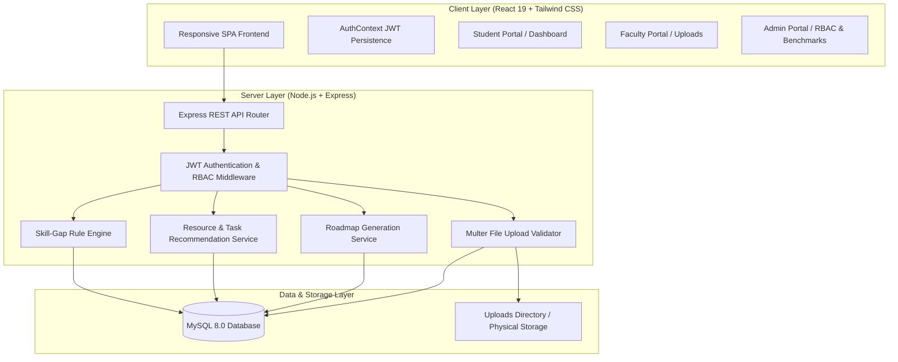
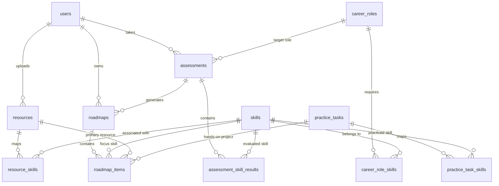

# LearnSphere — System Architecture & Design Specification

## 1. System Overview

**LearnSphere** is an integrated educational engineering platform designed for college Problem Solving in Engineering (PSE) Module 5. It unites two critical subsystems into a single full-stack web application:

1. **Academic Resource Management Subsystem:** Centralizes lecture notes, PPTs, lab manuals, tutorials, and capstone briefs previously scattered across informal channels (WhatsApp groups, LMS, personal Google Drives).
2. **SkillBridge Subsystem:** A deterministic, rule-based skill-gap analyzer that assesses engineering student proficiencies against target industry career roles, calculating exact skill gaps and sequencing personalized learning roadmaps.



---

## 2. Relational Database Design (ER Diagram)

The database consists of 12 normalized relational tables with enforced foreign key relationships and index optimizations:



---

## 3. Skill-Gap Rule Engine Mathematical Formulation

The skill gap calculation is transparent, reproducible, and deterministic:

### 1. Skill Gap Formula:
$$\text{Skill Gap} = \max(\text{Target Proficiency} - \text{Current Proficiency}, 0)$$

Where:
- $\text{Current Proficiency} \in \{1, 2, 3, 4, 5\}$ (Self-assessed on the standardized scale)
- $\text{Target Proficiency} \in \{1, 2, 3, 4, 5\}$ (Configured benchmark level for the career role)

### 2. Gap Percentage Formula:
$$\text{Gap Percentage} = \begin{cases} 
\left(\frac{\text{Skill Gap}}{\text{Target Proficiency}}\right) \times 100 & \text{if Target Proficiency} > 0 \\
0 & \text{otherwise}
\end{cases}$$

### Known Mathematical Vectors:
- Target = 4, Current = 2 $\rightarrow$ $\text{Skill Gap} = 2$, $\text{Gap Percentage} = 50.00\%$
- Target = 3, Current = 3 $\rightarrow$ $\text{Skill Gap} = 0$, $\text{Gap Percentage} = 0.00\%$
- Target = 3, Current = 5 $\rightarrow$ $\text{Skill Gap} = 0$, $\text{Gap Percentage} = 0.00\%$

---

## 4. Role-Based Access Control (RBAC) Security Architecture

Permissions are enforced on every Express REST endpoint using dual-tier middleware:

1. `authenticateToken`: Verifies the cryptographic validity and expiration of the incoming JWT Bearer token, checks if the user account remains active in the database, and injects `req.user`.
2. `authorizeRoles(...roles)`: Verifies that `req.user.role` matches the permissible permissions for the endpoint.

```text
Student Registration ──> Enforces role: 'student' (Public registration cannot create privileged roles)
Faculty Resources    ──> Ownership check: Only uploader or Admin can edit/archive
Roadmap Progress     ──> Ownership check: Students can only read/update their own roadmap items
Direct API Bypass    ──> Returns HTTP 401 Unauthorized or HTTP 403 Forbidden
```
